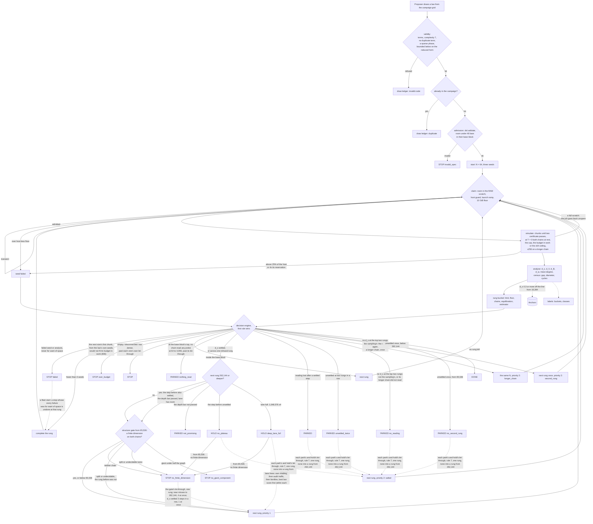

# Decisions: which laws get more compute

One engine decides, after every rung of every law, whether the law gets its next rung. This page is the rules in
force, as `graph_scale_dynamics/decisions/` has them; the operator's decisions behind them are `docs/HISTORY.md`, "The
operator's standing decisions". Rules revision 782 (`decisions/engine.py`, `RULES_REVISION`); the depth rules are 631's, the
only ones the code has (`engine.policy.depth_rules: 631` in the shipped spec). File references are to `graph_scale_dynamics/`. Numbers are the shipped survey's
(`resources/configs/campaign_engine_survey.json`) where it overrides a code default. The thresholds were set before
the pilots from 169 on; each is read again on their laws through its gate's let-through ("The tree of gates") and
moves only with the operator's word. What is known is `docs/RESEARCH_METHOD.md`.

**A reading is a probe value its bucket does not refuse**: a value can be present below the connectivity floor or with
disagreeing chains, and a refused value is not evidence.

## How a law moves through the rungs

Every law is proposed, admitted, simulated rung by rung, measured, labelled and decided on; at each step it can be
stopped, held, parked or sent deeper.

The chart draws a law decided by its chain from empty. In a campaign decided chain by chain (every study's since 169), from the
last base rung the starts' rule decides depth in place of d_s's rules, and the structure gate reads each chain alone. The
ladder ends at 1,048,576 with one lane four wide. No rung has a memory ceiling of its own; 35% of the host is an
analysis given back's (`scheduling/memory.GIVEN_BACK_CEILING_FRACTION`). Of the dotted arrows only the let-throughs,
the lane's release of a hold, the gate's audit and plateau follow, and a fleet start's undoing of a stop made for want
of space decide whether a law runs. The chart is drawn as `docs/diagrams/rung_flow.svg`
(`tools/diagrams/export_mermaid.js`, checked by `tools/check_svg.py`): export it again whenever the source above
changes. Every gate, stream (`decisions/gates.STREAMS`) and evidence table as the code has them is
`docs/diagrams/gates_and_streams.svg` (`tools/gates_map.py`), held current by a test.

### 1. Proposal (`services/proposer`)

| Check | Rule | Outcome |
|---|---|---|
| Window open | fewer than `pool_min` (32) laws proposed and fewer than 48 + 32 in their base block | draws `32 - proposed` |
| Grid draw | up to 200 tries per law; a stream out of tries draws on, 50 times (`GRID_RETRIES`) | the stream ends its batch; a failed campaign is logged (`top_up_failed`), the rest served |
| Validity, in order | `no_terms`; `over_budget` (complexity above 7); `duplicate_term`; `no_sparse_phase` (no term with c0 > 0 that empties the graph); `unbounded_below` (on the reduced form, `effective_basis`: a negative `degree_square_sum` after a degree anchor or wedge count is folded in needs a positive degree fourth sum on the same scale) | `invalid:<code>` in the draw ledger |
| Duplicates | same fingerprint, or same equilibrium identity | `duplicate_law`, `duplicate_identity` |
| Every draw | `proposal_draws` | the survey's denominator |

A law is in its base block while it has no decision or its latest buys a base rung; held laws and buys above it take
no place. A campaign at its law budget proposes no more.

**Before the chain: the pool.** A design leaves a term out of its pool (`terms_left_out`), so no law carrying it is
drawn and the law budget is the laws that run.

### 2. Admission (`services/controller/engine_campaign.py`)

`dsl.validate`: |c0| at most 1,000, powers in [-2, 2], beta in (0, 100], sweeps in [1, 100,000], init `empty`; a
failure is `STOP invalid_spec`. Room is `max_active_candidates` (48) less the laws in their base block
(`scheduling/admission.py`), a law the controller's last pass left waiting to learn holding none, at most one learning
group of them (`learn_in_batches_of`; 834, `note_waiting_to_learn`, the flag `learning_waits:<campaign>`, which the
proposer's window reads too). Admitted: `BASE_BLOCK_RUNNING`, and the rule `start` enqueues N = 64.

### 3. Memory (`scheduling/memory.py`)

The scratch's room, the headroom and the small pool are `docs/ARCHITECTURE.md` ("Scratch", "Memory admission"); a
job that meets a full scratch goes back unspent, never counted toward the three failures that stop a job.

**The claim, in two halves** (`services/worker/main.claim_simulation_for_owner`, `scheduling/fleet_halves.py`). The seed
whose room is held (item 5 below) comes first; then the half owed the worker: extension (every rung from 16,384) while
it holds fewer than half the running simulations (the asking worker counted, the half rounded down), else base
exploration. Extension takes, deepest first, the lanes' reserve (three workers from 1,048,576) and the extension reserve
(while fewer than two run from 32,768 up), then its rungs below the lanes by the priority each was bought at, then
longest queued (741; oldest first before), as extension's analyses are; base exploration takes two workers on rungs to
1,024, then the base block by rank. A half with nothing to take hands the worker to the other; the lanes past their
reserves come last. The reserves serve first the campaigns furthest below their share, then every campaign. Analyses are
divided the same way (`services/analyzer/main.claim_analysis_for_owner`): extension's by the priority its rung was
bought at, then longest queued; base exploration's by rank. Each claim then meets, in order:

1. the host guard: memory used 90% or more, available under the 10 GiB floor, or pressure (PSI some avg10 at least 5,
   full at least 1): transient, retried in 5 s;
2. the launch ramp: too much granted in the last 20 s or 2 s: transient;
3. predicted above the single-job ceiling (25% of the host, every rung and stage): reserves the ceiling and runs;
4. larger than the whole host less the floor: permanent; the seed or analysis fails, so the law stops on it;
5. over the budget: transient. A lane's seed (from 1,048,576) refused here has its room held, the first claim any
   worker tries, until it runs, no longer waits, or an hour passes; then a pause of half an hour, doubled for each
   hold in a row that ran out, to eight hours (`scheduling/memory_hold.py`).
   A worker refused here claims again below the refused seed's size (747).

Small claims (at most 1% of the host) borrow the large children's growth still to come. When available memory falls
2 GiB under the floor, running children are shed, least compute lost per byte first, and resume from their last chunk.
A child past the ceiling or four times its reservation (at least 2 GiB) is stopped and its seed failed with the reason.

### 4. Simulation, per seed (`scaleflow/one_shot.py`, `scaleflow/equilibration.py`)

**The budgets in work** (806): every size's seed has a budget in units of the engines' weighted count of work
(`engine.policy.work_budgets`; `docs/ARCHITECTURE.md`, "Limits"), fixed in the design before the study and never
moved while it runs. The survey's are the seconds of its old windows on the sandbox's unit: 4.0e11 units (about 60 s)
for 64 to 4,096, 2.0e12 at 16,384, 2.4e13 at 65,536, 9.6e13 at 262,144 and 2.9e14 at 1,048,576; a design gives its
own in its ladder's `budgets`. No clock ends a seed: the run is cut at its budget, between chunks when the work done
and the next chunk's, predicted from the last chunk's work a move, would pass it, and since 840 inside a chunk that
passes it all the same (reason `budget` both ways); its chains are read where its last whole chunk ended and the rung
decided as any other; a seed that ended there is the same on any machine, only slower or faster to compute. A rung bought on the law's own reading runs at twice its budget (`merit_budget_scale`).
A seed resumed from its last saved chunk counts the work before that save once, as its accounting is cumulative.
Every decision records how much of its budget each seed used (`facts.budget_use`; `facts.budget_ended`, which seeds
ended at it), and report 28 bands the seeds (under 1%, 1-10%, 10-50%, 50-100%, reached) by where the engine lands each
law. **A seed that cannot start is not started** (`budget_gate`): before a decision buys the next size, its first chunk
is predicted from the law's own seeds a size below (`first_chunk_prediction`, `facts.first_chunk`), and a law whose
first chunk would not fit is stopped as `over_budget`, a price and not a verdict: no let-through, and the ledger does
not count it, unless a design sets `ledger_counts_priced` (841, study 173): then the verdicts such a law carried
(`facts.salted`) are judged as a stop would judge them and counted as held. A longer chain at the size a law is at is
priced from that size's seeds; since 835 its reason says so (`engine.over_budget_reason`; before, it read as a first
chunk at the next size, and replay reads the former words as today's); on a design's `longer_chain_budget_scale` (2 in
study 173, 841) it is priced against, and run on, that many times the size's budget. The ladder counts such a law
under `priced`, among its stops (`budget` from 839 to 840, parked before), and its evolving `cut` column (`ended`
before 839) counts laws with a seed that reached its budget mid-run. **The cut gate** (841, `decisions/cut.py`, on a
design's `cut_gate`): a decision that would buy a larger size, or a longer chain at the same size, for a law with a
seed that ended at its budget at the size it is at carries the verdict `cut` (`facts.cut`: the seeds, of how many). At
the gate's share of 1, study 173's, the law goes on with the verdict recorded, so the gate is judged one size up on
every such law; below 1 it stops the law there (`STOP cut`, a stop column of the ladder's own once any law is so
stopped), its share let through. The operator first asked for it to stop a law (2026-11-21 19:26); 172's decisions
replayed so lost 7 of its 22 scoring laws at 4,096, its second best among them, and the operator chose to record it
(21:03, "Record only")
(835; the operator, 2026-11-21 02:32, on the tooltip: "park != stop I guess?").

Chunks run every chain of the seed until the first of:

| End | Seed label |
|---|---|
| mean degree above the cap (16, armed from 64) | `REFUSED_MEAN_DEGREE_ABOVE_WINDOW` (no probe is measured) |
| the budget in work: the next chunk would not fit (806) | as at the ceiling, by its certificate at its last state; `rung_terminal.work` holds the chunk it refused |
| two certificate passes in a row ("How a rung is judged thermalized") | `EQUILIBRATED_ACTIVE`, or `EQUILIBRATED_LOW_ACTIVITY` at 0.05 changes per node or fewer; `AT_REST` at zero temperature |
| the x64 sweep ceiling | `FROZEN_OR_ABSORBING`, `METASTABLE_OR_NONMIXING`, `RELAXING_AT_CEILING` (still falling at zero temperature), `INSUFFICIENT_EFFECTIVE_SAMPLES` or `OPERATIONAL_UNRESOLVED` |

One rule since 781 (the operator, 2026-11-14 18:37 to 18:55; `docs/ARCHITECTURE.md`, "The certificate"): every
graph must stop changing, so every chain that ran decides the chunk loop by its own certificate (its own count, drift
and structural trend at a finite temperature, its own rest at zero), and a rung is frozen only when every chain is; at
a finite temperature the twin starts, the chain from empty and the random start's, must also land together, and no
other pair is compared; at zero temperature where each chain rests is the finding. Every chain at the cap ends alone,
the chain from empty too: a twin alone at the cap is the twins apart at a finite temperature and left out of the
chains that must rest at zero, a lattice chain at the cap holds nothing back, and the rung is refused at the cap when
both twins have crossed it. A spec's `sampling_contract.lattice_chains_meet` is carried and decides nothing.

### 5. Analysis and the rung's bucket (`measurements/estimators.py`, `analysis.py`, `scaleflow/flow.py`, `scaleflow/probes.py`)

A largest component under 16 nodes refuses every probe, and so does a graph whose balls hold more than 0.55 of it within
four steps (762, `NO_SCALING_WINDOW`: too small to tell how its balls grow). d_V is the slope of a line through the
upper half of its window against a ball's half width r+1/2 (761; a line since 762). Its window (763,
`estimators.last_radius_of_the_window`) ends, coming down from the largest radius whose mean ball holds under 0.55 of
the component, at the first radius where the balls' local exponent is within 5% of the steepest so far, or, from radius
8, where the exponent's fall from one octave to the next has slowed to 0.65 of the fall before it: a strip and a slab
are read at the scale where they are a line and a plane, where the steepest radius, 762's end, was their short scale.
The window needs 4 usable radii, and under 4 no probe reads (763, `NO_SCALING_WINDOW`: too few radii to tell how the
balls grow). d_V's error is a bootstrap over sources in which every replicate finds its own window (763), so it says how
far the window's end moves with the sources. Where the fleet reads a graph the balls are counted from 128 sources up to
4,096 nodes, halving as the graph doubles and never fewer than the 24 to 40 of before (764,
`estimators.sources_for_the_verdict`): from 24 sources the verdict on a small graph moved with the draw. The balls'
growth has one verdict over that window (`estimators.growth_of_the_balls`): exponential when the exponential in r fits
better than the power law in r+1/2 by 4 in AICc; undecided unless the power law is better by 4 and the exponent over the
last third of the window is at most a third above that over the first (762); uneven (763) where at some radius of the
window the sources' balls lie more than 0.85 apart in their logarithms, a dimension being the same from every node and a
tree with hubs not; a power otherwise. Where it is exponential, undecided or uneven no probe reads, d_s among them (the
operator, 2026-11-11 10:46): each refuses as `EXPONENTIAL_GROWTH`, `GROWTH_UNDECIDED` or `GROWTH_UNEVEN` and keeps
beside the refusal what it would have read. d_s (762) is twice the slope of a line through the latest third of its
usable times, a grid of up to 28 from 3 steps to where the return probability falls to 4/N or the walk of 260 to 1,024
steps ends, nothing taken off; it is withheld where the flattest third, with 1/N taken off, is not a power law better by
2 in AICc, as 761's fit was, where its own stretch is not (`NO_DIFFUSIVE_WINDOW`, recorded with which way the margin
went), and as `NOT_SETTLED` where the slope moves from the first half of the stretch to the second by more than a tenth
of the reading and two of its errors. d_B (760, `measurements/box_covering.py`) is one straight line of the log of the
box count on the log of a box's width 2r+1, over the whole radii from 3, or from where the balls' exponent has settled
if that is later (763), to the largest whose mean ball holds an eighth of the component, three greedy covers a radius;
it refuses under 4 radii (`WINDOW_TOO_SHORT`) and where an exponential fits better by 4 in AICc (`NOT_POWER_LAW`). The
exponent has settled from the first radius whose exponent over the octave below is within a tenth of d_V
(`estimators.radius_the_exponent_has_settled_from`: 1 to 4 on a lattice, 11 on a strip four around). d_w (760,
`measurements/walk_dimension.py`) is one straight line of the log of the walker's mean square distance on the log of
time, from 8 steps, or from the time that distance reaches the settled radius squared if that is later (763), to a
quarter of the distance of a walker that has forgotten its start, 16 walks from each of 48 sources; under 5 times in
that window it refuses, as `WALK_SATURATED` where the walk passed that quarter and as `WINDOW_TOO_SHORT` where it ended
first. The verdict on the balls is made once, in one place: the walk probe's own second test left at 763. **It is relied
on from 4,096 nodes**, the last size of the base block every law runs (the operator, 2026-11-12 11:14;
`scaleflow/probes.A_VERDICT_IS_RELIED_ON_FROM_NODES`): under that a reading is kept and useful and not relied on, a
hyperbolic geometric graph of 1,024 nodes having six to ten radii over which its balls fit a power as a geometry's do
(read on 24 of 30 draws, and on 29 from five times the sources). Each probe draws from a random stream of its own
(`estimators.streams_of`, 762). On a tree or a sparse random graph the box counts alone fall like a power over the few
radii a cover has, and until 761 d_s read the tree line there, which is why the balls decide
(the notes of 760, section 6, and 761, section 3, in their archives). What the instrument does not read at
the scales its windows reach, each with its numbers, is in build 763's notes, section 5 (its archive): d_s where a
walk has not left a short scale (a sparse plane, an open patch, the Vicsek fractal) and d_w on a strip more than two
around. The tree has one analysis, named in `measurements/version.py` and in a campaign's spec, and a spec that names
another is refused (analysis-5.3.0 since 760; the older analyses left the code at build 759). A chain is read at its last state and none of its snapshots; d_s carries the error the probes measured
(`measured_se`) beside `se`; every reading says whether its graph is a small world. The census reads the spectral gap up
to 65,536 (on the 2-core where it holds at least half the component, `structure-census-3`), the diameter at every N,
cliques and the k-core up to 262,144.

A rung takes the first bucket that applies: a limit terminal; below the connectivity floor (0.5); chains disagreed;
never equilibrated; no effective sample; not attempted; a usable reading; the estimator's own refusal. Decisions read
each seed's best run at a size (`db/decision_store.best_runs`), so a rung run again with a longer chain is read on that
run; sampler audits are left out. A longer chain starts again from move 0 on the same streams, so a sampling refusal
whose given chain ended at the cap is the search's limit (`facts.d_s_refusal.given_at_cap`): the law parks at once.

### 6. The decision engine (`decisions/engine.py`, rules revision 782)

**784's one let-through rule** (`Policy.let_through_rule` = `gsd-let-through-1`, a design's `engine` block; the
operator, 2026-11-15 13:52 and 14:07: "no gate should default to closed at start, all of them should self-confirm
from within our pilot data alone", "apply the same gate at every rung, each with its own counter"). Every gate at every
size has its own counter, learned from the study's own decisions, every batch of it (831; the operator, 2026-11-20
10:32: "They should technically function as 1 study"; `DecisionStore.learning_laws` reads every campaign of the
folder's study on the same rules, `study_batches`, each in its place in the study's design, and a campaign outside a
study reads itself) at fixed points in the laws' own order (806, `decisions/let_through.FixedPoints`,
`gsd-learning-at-fixed-points-1`): each batch's laws are taken in their numbers and cut into groups of
`learn_in_batches_of` (100), a group holding those numbers of every batch (laws 1 to 100 of each of five batches the
first, 500 laws); a law of group g decides at a size from the ledger of groups 0 to g-1 at that size, fed in the laws'
order (the number, then the batch's place), and only once the group is closed in every batch (832: the batch has drawn
past it, or holds its whole law budget) and every law of it is past the size (a verdict above it, or ended). Since 834
it decides sooner wherever no earlier law can still change what it learns (`FixedPoints.determined`; the operator,
2026-11-20 23:37, after study 171's laws waited hours on others' 16,384 and 65,536 rungs): every earlier law ended or
decided at the size (a held law is not), fewer than `confirm_after` let through at it by any gate whose share is learned,
those still undecided counted as if they would be, and, where repeats_a_known_result can withhold there, fewer than
`known_result_after` sharing any one signature. It then meets every learned gate at 10% and sees no signature, as the
whole ledger would give it; its inputs say so (`learned.determined`, no shares listed). A repeats_a_known_result that
only records (its share 1) learns no signatures (834), so it marks no law. Until one or the other, it waits (`pending: learning`),
so a slower batch holds the others' later laws back. **Since 842 a law waits only where something is still learned**
(`let_through.learns`): a gate whose share is learned (no share of its own in the design, `learned_gates`) or a
repeats_a_known_result that acts (`known_results_learned`). A design that gives every gate its own share, as study 173
does, learns nothing from earlier laws, so no law waits for them and its inputs carry no `learned`: on 841 such a law
still waited while 100 or more earlier laws were undecided at its size, a wait that changed no decision. A group whose members change after
it was learned from (a budget raised on a finished batch, a batch paused, archived or resumed) is learned from again
(`FixedPoints.members`), so a running controller and a fresh one learn alike. A batch paused by its share (0 workers)
or not active is not read, but by itself. So the share a law meets, and the signatures it is held to, depend on the
study's laws and not on which finished first. The group, its laws, the decisions read and, where the study reads more
than one batch, the batches read with their places (`campaigns`) are in the decision's inputs (`learned`), so a
decision replays; one made on one campaign replays as recorded. On study 170's bundle (`tools/counters_reading.py`, criterion
`study_counters_criterion.json`): read as one study, the shares 527 of its 4,808 learned decisions met change, all
from 4,096, and none of their decisions does. Below `let_through_from` (4,096) every verdict is recorded and every law goes on: the base block records
only, and each verdict is checked one size up. From it a gate lets 10% through, drawn a size at a time by a hash of
the gate, the size and the law (`gates.drawn`; since 835 a design's `one_die`, study 172's, draws one pick a law a
size, a hash of the size and the law that every gate reads, so a law two gates would hold back goes on at the share
and not at its square: the operator, 2026-11-21 02:59, after study 171, a pick for each gate, let 2 of the 359 laws
both the empty and the disconnected gate would hold back at 1,024 go on, and 24 of the 252 one gate alone would hold),
until `confirm_after` (100) of its let-through laws in a row were
withheld again one size up (by any gate; `same_gate` counts the ones the same gate withheld), then 1%; a law that
passes every gate one size up is a miss and puts it back to 10%. Nothing is spent: a law let through at one size meets
the gate afresh at the next. The depth bar (`not_promising`) lets through as every gate does, and a law already let
through is not barred. A failed rung and the ladder's top judge nothing (`open`). Every chain decides alike, and at
the top a chain that completed the ladder names the law, not the chain from empty's stop. **`repeats_a_known_result`**
(`decisions/known_result.py`; `seen_enough` until 835, the operator, 2026-11-21 02:32: "Yes, that is a better name
indeed, its exact"; a design, a recorded policy or a decision in the former names is read in today's,
`engine.FORMER_FIELDS` and `gates.in_today_s_words`, and a policy's fingerprint and the gate's pick are what they
were): from 4,096 every decision carries the law's signature, what each chain is at the size
(empty, dense, dust, or its mean degree and its dimension to the half, with a lattice start's fate); once
`known_result_after` (100) laws with a signature were read one size up with it still, a law that would go on with it
is withheld (`repeats_a_known_result`, PARKED) under the same let-through, the signatures learned at the same fixed points as the
shares. The study's bundle carries the ledger
(`gates_ledger.json`). **Since 789** a design may start the rule lower (`let_through_from`; 256 in study 170, so the
base block's fact gates act), read `repeats_a_known_result` from a size of its own (`known_result_from`), put every gate at
one fixed share (`ab_share`, the operator's "A-B testing", 2026-11-16 11:05): each law's arm is drawn once
for each gate from its identity, so a law in a gate's B arm is never held back by that gate at any size, the halves do
not compound, and no gate confirms; and park a law the dimension test reads only through lattice starts that kept
their shape (`kept_shape_park`, rule 11). **Since 790** the ledger also counts, at each gate and size, the laws it held
back (`held`, each once) and, where the laws' scores are known, how many of those it let through score above zero
and the best of them (`scored`, `best_score`, `best_law`): each batch's landscape scores its own laws and the study
view adds them; a bundle's ledger lists each counter's let-through laws (`laws`), which `tools/study_baseline.py`
scores law by law. Home shows it all in the gates box under the fleet ladder. **Since 794** a design may give a gate
its own share from `let_through_from` (`gate_shares`, pairs of a gate and a share, ahead of `ab_share`): 1 records
the gate and holds no law back by it, 0 closes it; a gate's own share does not move when it confirms, so study 173's
six acting gates let a tenth through at every size (the operator, 2026-11-21: the let-through stays a tenth through
the pilot). **Since 844** a design may also give a gate the size it acts from (`gate_from`, pairs of a gate and a
size, `Policy.acts_from`): below it the gate's share is 1, its verdict recorded and the law let on; from it, its own
share. Study 174's `nothing_read` acts from 16,384 (the operator, 2026-11-22 15:38). `nothing_read` reads what the score reads: a chain has read at a size when a probe passed the analysis's
checks or, from 4,096, read on a piece of 4,096 nodes or more, as `law_score.piece_holds` counts it; on a design's
`nothing_read_piece_share` (0.9 in study 173, 841) the piece is that share of the graph, at most 4,096 nodes, so a law
read on 3,993 nodes of 4,096 is read.

The rules stand until the positive control passes, bugs aside (`docs/ROADMAP.md`). A gate that stops compute lets a
share of the laws it would stop through, by a hash of the law and the gate's name (a gate 773 renamed hashes its name of
772, `gates.SALT_STREAM_LABELS`, so the same laws go through): the let-through. The share is
`audit_fraction` (10%) where the campaign names none; in a study's campaigns each gate's own at each size, learned
from the study's own decisions ("784's one let-through rule"); a policy's `salt_shares` (`Policy.salt_share`) fixes
them. From 16,384 a gate lets through at most 0.5%
(`deep_salt_at_most`), and none into a rung of 262,144 or deeper, so a gate that fires only from 65,536 is never
tested. The code and records keep the older word salt (`salted`, `salt_spent`, `salted_from`, `salt_shares`,
`salt_ledger.json`): renaming would move every running campaign's rules fingerprint. First rule that applies:

| # | Rule | When | Action |
|---|---|---|---|
| 0 | `failed` | a seed or analysis failed for good (the third failure with one reason; an interruption or a dead worker is none, and since 786 a seed whose worker vanished is queued again, never lost), or the law's evidence can never be read (its rebuild failed for good, or its decision failed alike on five passes over an hour). A fleet start undoes, once per rung, a stop whose every failure was for want of space or the fleet's (`law_reinstated`, no decision row) | STOP |
| | `start` | no rungs yet | N = 64 |
| 1 | `complete_rung` | the top rung has fewer than 3 seeds measured | the same N |
| 2 | (a budget's end) | a seed whose next chunk would not fit its budget in work ended there (806; `facts.budget_ended`: which seeds, of how many, at what size), and the rung is decided by the rules below as any other; its rung is classed by its certificate at its last state, as at the ceiling | as decided |
| 3 | `empty`, `disconnected`, `too_dense` (the fact gates) | mean degree at most 0.05 at every rung from 256; connected under 0.5 from 1,024 and not growing; mean degree at the cap from 256. On a design's `fact_sizes_in_a_row` (3 in study 171, 828; the operator, 2026-11-20 11:27: "always require a trend of 3 rungs in a row"), each only on that many sizes in a row, so from 1,024: empty at all three and not rising (the last the highest and above the first), at the cap at all three, under 0.5 at all three and not growing at the last. Each chain decides alone and a law stops only when every chain stops. Each lets its share on one rung (`facts.salted`); one the same verdict meets again stops (`facts.salt_spent`) | STOP |
| 4 | `base_block` | below 4,096 | next rung |
| 9 | `nothing_read` | since 782, on unless a design turns it off (`engine.nothing_read_gate`): at the top of the base block, a decision that would buy a larger rung for a law none of whose chains read any probe at any size from `nothing_read_from_n` (64) to 4,096; read last, after every other rule (`decisions/nothing_read.py`). Its let-through keeps the other rules' decision for one rung (`facts.salted`, `facts.nothing_read.salted`); a let-through law that reads nothing at that rung either parks there (`salt_spent`) | PARKED |
| 9a | `no_steady_chain` | 796, a design's `steady_chain_gate` (the operator, 2026-11-18 10:17): at 4,096, after `nothing_read`, a decision that would buy a larger rung for a law none of whose chains was steady and moved by the law from 1,024 to 4,096 (in one piece, under the cap, above a ring, its mean degree within 3%, its reach 1.35 times or more, at most 1,680 squares a node; a lattice no edge of which changed is steady but a known answer); its let-through as every gate's (`decisions/steady_chain.py`, `facts.steady_chain`) | PARKED |
| 10 | `repeats_a_known_result` | 784's rule only, from 4,096: the law would go on, and 100 laws with its signature at this size kept it one size up; let through as every gate is (`decisions/known_result.py`; `seen_enough` until 835) | PARKED |
| 11 | `kept_shape` | 789, a design's `kept_shape_park` (the operator, 2026-11-16 10:54): where the dimension test would buy the next size and reads only lattice starts that kept their shape and their own d (732's tier 3); everything measured kept, the class to be extended by a study of its own; let through as every gate is (`decisions/starts_rule.shown`) | PARKED |
| 11a | `cut` | 841, a design's `cut_gate`: after every rule but the price, a decision that would buy a larger size or a longer chain for a law with a seed ended at its budget at the size it is at (`decisions/cut.py`, `facts.cut`); at a share of 1 (study 173) recorded and the law goes on, below 1 stopped there, its share let through | STOP |
| 12 | `over_budget` | 806, after every other rule: a decision that would run the next size, or a longer chain, whose first chunk, predicted from the law's own seeds a size below (the same size's for a longer chain), would not fit that size's budget in work (`budget_gate`, `facts.first_chunk`); no let-through: a price, not a verdict | STOP |
| | `ladder_complete` | no rung left | DONE |
| 5 | `d_s_settled` | the last d_s step within 2 combined standard errors, or across one refused rung; where both readings carry `measured_se`, within twice their combined measured error plus the drift a known geometry still makes between the two sizes (`calibration/finite_size.py`, fits frozen into the campaign; `facts.d_s_settled_by`) | next rung, priority 1 |
| 6 | `no_plateau`, `deep_lane_full` | into 262,144 or deeper (`plateau_from_n`): the step before settled too; a lane rung needs room (1,048,576: 4 laws, `deep_lane_widths`) | HOLD, with what was missing |
| 5 | `reading_lost` | d_s lost at the top after a settled step | PARKED |
| 5 | `longer_chain` | no d_s at the top two rungs, the top one refused by the sampling (chains disagreed, no effective sample, never at rest), not yet rerun: every seed again from twice its longest chain to four times the cap (`longer_n<N>_x<M>` jobs), its window unchanged; a base-block rerun waits at the base block's rank | the same N, priority 2 |
| 5 | `no_reading` | no d_s at the top two rungs: after the longer chain where the sampling refused, at once where the graph or the search limits did (`facts.d_s_refusal`) | PARKED |
| 5 | `unsettled_twice` | d_s unsettled at two rungs in a row from the base block's top (a pair across a refused rung counts once; a rung with no step counts as a look) | PARKED |
| 5 | `second_rung` | unsettled once (or the top rung one reading short of a step), the next rung below 262,144 | next rung, priority 2 |
| 5 | `no_second_rung` | unsettled once, the next rung needing a plateau | PARKED |
| 5 | `unsettled` | a campaign declaring `second_rung: false`: anything else | HOLD |
| 7 | `salted` | the let-through of a park or hold of rule 5, of `no_plateau` or of the starts' rule; a full lane still makes it wait; the same gate again at that rung stands (`facts.salt_spent`) | next rung, priority 2 |
| 8 | `no_finite_dimension`, `no_giant_component` | from 65,536, on a rung another rule buys or holds for: no finite dimension on either chain, split or undecidable at two rungs in a row, or a giant under half the graph | STOP |
| | (the gate's let-through) | its share keep the other rules' decision for one rung (`facts.gate.salted`); refused again there, the law stops | as decided |
| | `gate_audit` | a refusal within 0.1 of the gap threshold or 0.05 of the diameter threshold on either chain, the rung at 262,144 at most; at most 4 in flight | next rung |
| | `plateau_follow` | a refusal for a law whose d_s settled at 3 steps in a row or more; one law at a time | next rung |

`longer_chain` counts as `no_reading`'s first step (`gates.gate_of`). **Beyond the base block a rung is bought by d_s
settling, whatever the mean degree does** (`decision-engine-2`); each reason says why d_s did not settle, whether the
mean degree moved (a fact, never a condition) and which other probes read. Mean degree decides only `empty` and
`too_dense`; mean-degree settling gates nothing (the operator), and since 790 no reason reads d_s against it. A disagreement between chains is recorded on every decision and never stops a law.

**The structure gate** (rule 8, `decisions/structure_gate.py`; policy field `structure_gate`, on). From 16,384 it
reads every decision that would buy or hold for a rung (`GATED_RULES`), and only refuses; its facts are under `gate`,
the other rules' decision under `gate.underlying`.

* **The rule**, committed from the fifteen calibration families before any law was read
  (`resources/calibration/structure_thresholds.json`, held equal to `Policy` by a test): a finite dimension is a gap
  exponent over 4,096 to 65,536 at most -0.309 (on the 2-core; the survey's, against the code's -0.3752) and a
  diameter exponent over 4,096 to 262,144 at least 0.1751, against the giant's size, on rungs whose giant holds at
  least half the graph.
* **Both chains**, from empty and from the first given start: both finite, the decision stands; neither,
  `no_finite_dimension`. A split ("chains disagree on structure", as when a chain started at a declared family reads
  finite and the chain from empty does not) or an undecidable reading gets one more rung, refused if the rung before
  read the same. Undecidable: too few rungs in a window, a gap the solver could not read, exponents no graph can have,
  a gap that opens with N or a diameter that shrinks, or a chain from empty read finite whose log-diameter flag is
  raised or unknown at the top rung. A chain from empty whose giant is under half the graph stops `no_giant_component`.
* **Two stages**: at 16,384 a clear case (a gap exponent above -0.2 and a diameter exponent below 0.13 over 4,096 to
  16,384, both chains) is recorded as "would refuse" (`early_stage`); it acts only on the operator's switch, once 100
  laws it would have refused were refused by the full rule at 65,536 (the count, folder-wide, in each 65,536
  decision's facts). The full rule acts from 65,536.
* **No known pattern** (790): the branching line, d_s within 0.1 of mean degree less one, was the gate's one known
  pattern and left with the tree line's logic (the operator, 2026-11-11 10:46: "drop the tree line logic and rely
  solely on the probes themselves"); a refusal says what the structure read, nothing else. Where the rule alone is
  fooled: `docs/RESEARCH_METHOD.md`, "The instrument and its known limits".

**The lanes.** A lane's waiting laws (`facts.lane`) are bought as room opens: laws on their own reading first, then
audit traffic (a let-through, the gate's audit, the plateau follow), then laws that reproduce a calibration family,
best law score first within each (the operator's choice; `db/decision_store.laws_waiting_for_the_lane`), the one place
a scheduling decision reads a score. In flight at a lane: laws whose latest decision buys its rung or with queued or
leased, unparked seeds at it, never a terminal law. At a full lane an audit law yields to each waiting law of the first
kind: a `deep_lane_full` hold with `facts.yielded`, its queued seeds parked and its running ones stopped with their
chains saved (`db/lane_yield.py`); offered room again, it resumes where it stopped (`lane_resumed`).

**Every chain alike** (`decisions/every_chain.py`): a campaign that lists its starts and declares
`engine.policy.every_chain` puts each chain to the rules alone, on its own rungs (a given chain's structure
read as a pair of itself). The law takes the decision of the chain that goes furthest: a rung on a chain's own reading
first, the furthest first, then one for an audit, then a hold; else the chain from empty's. Of two chains earning the
same rung the stronger reason goes first (`every_chain.STRONGER_FIRST_FROM`). Every chain's decision (`facts.chains`),
the chain that earned the rung (`facts.earned_by`) and every given chain's rungs (`inputs.chains`) are recorded. A
chain whose readings stop below the top rung of the chain from empty takes no part, and since 792 neither does a
chain read at that rung alone, from 4,096 on, where a decision needs the rung below (a lattice chain of a law at the
degree cap with no census below its top: on 791 the engine failed on it). At a finite temperature chains that
disagree withhold every chain's readings at that rung.

**The starts decide depth** (the operator, 2026-10-08 09:04 and 12:50: "extend based on the new rules instead";
"Fix it, then let it decide"). In a campaign decided chain by chain, from the last base rung, a decision by one of
d_s's rules of depth (rules 5 and 6 bar `longer_chain`, or a let-through past one; `starts_rule.D_S_DEPTH`) is
replaced by the starts' rule's (`decisions/starts_rule.py`), read by `observability/starts_reading.py` (checked on
known answers: `resources/readings/starts_known_answers_criterion.json`, 819) at the law's largest size two chains read:

| class there | decision | rule |
|---|---|---|
| a shape: one_space, grows, converts, selects, holds (a lattice start that holds: kept 0.8 to 2 of its start's reach with its degree, and moved; where the spec sets `sampling_contract.hold_structure`, its mean degree, squares and triangles a node also within 5% of its start's, else it changed) | the next size, priority 1 | `starts_shape` |
| forgets: every start alike, no shape held | parked, whatever d_s did | `starts_alike` |
| remembers: the starts apart, no shape held | the next size once, priority 2 | `starts_apart` |
| remembers at two sizes in a row from the last base rung | parked | `starts_apart_twice` |

Each park lets its share through for one size (rule 7). A size bought meets the structure gate on each chain alone (the
first chain to pass decides, the holding lattices first; an audit or plateau follow only where none passes) and, from
the plateau rung, its lane. Every other rule decides as it would, chain by chain. A law with no class (no size from
1,024 that two chains read), without its lattices' references, or read at a size with no lattice reference
(`unreferenced`; the references run from 1,024 to 1,048,576) is decided by d_s's rules (`facts.starts_reading.decided`
false). A decision of the starts' rule records what d_s's rule would have decided (`facts.d_s`) and what it read
(`facts.starts_reading`); a shape a lattice holds where the chain from empty would not climb is earned by that lattice,
and at the last rung, where that lattice completes the ladder and the chain from empty meets a verdict, the law
completes it too (`ladder_complete`, `facts.shape_over_verdict`; 734: before, the verdict of the chain from empty ended
it). **A shape buys one size**: a law above that
size with its starts unread there parks (`starts_shape_unread`). A park is not a verdict: every parked law is
decided again when the rules change; a verdict's stop stays.

**Depth earned** (`decisions/depth.py`). A rung from `promising_from_n` (262,144) needs the bar: the starts shaped
at the top two rungs, and a chain carrying the shape (from empty, or one grouped with a holding lattice start) reading
on its own rungs a small-world share below 0.5, a d_s step settled by rule 5 and d_V valid at a majority of its seeds
(decided by its chain from empty: that chain's readings, its plateau for the shape). A law that fails parks
`not_promising`, with what each chain read; no let-through reaches such a rung. The apart look reads the class history:
an apart law that read every start alike at the size below, or whose starts fell in two groups, parks
(`starts_apart_by_history`); one that read *selects* there buys at priority 1; a size the look bought and left
unread counts as a look. A shaped law is not stopped by the final verdict of its chain from empty where one of its
chains would climb, and `longer_chain` runs only where the starts' rule would keep the law. `research/outcome_ledger.py`
says whether each buying rule's reason held at the next rung.

**The dimension rule** (732; `Policy.dimension_extends`, off at its default and left out of the fingerprint there):
the rule is the engine's, and a design turns it on by name in its own `engine` block. The decider reads each chain's dimension with the starts' reading (`research/dimension_rule.block`: the dimension test of 729 on
the columns report 28 keeps for every chain; since 741 a chain counts only where its last usable size is the law's own,
so a chain dense, in pieces or unread at the size decided extends nothing, and the block names it, `not_read_at`). Where
the starts' rule would park a law (any of its four parks) or the bar would park it `not_promising`, and a chain reads
dimensional, the law gets the next size instead (`dimension_shows`, before the park's let-through), its decision naming
the park it replaced (`facts.overrode`) and the reading (`facts.dimension`); its reason names the chains it read in the
starts' order, the one definition's (`measurements/starts.py`: empty, given, then the lattices by dimension and then by
neighbours, honeycomb, square, triangular, cubic, bcc, fcc, tesseract; 745, `starts_rule.in_start_order`),
whatever order the evidence or the stored inputs give them, so it replays as made. A lattice chain keeps its lattice's
dimension (`kept_d`) when its d is inside the lattice's band or within half the band of the lattice's own d: the
cubic, 4D and honeycomb lattices have the bands of the dimension test's criterion (2.5 to 3.5, 3.0 to 5.0, 1.5 to 2.5)
and the own d the test measured again on the final probes at 808 (`research/dimension_rule.CALIBRATED_ON`,
`dimension_test_criterion_4.json`: the cubic lattice 2.89 at 1,024 where 729's probes read 2.54, the 4D 3.37 where
they read 2.71); since 769 the square and triangular lattices have the band of two dimensions and the
body-centred and face-centred cubic that of three, each with its dimension as its own d (the table reads them within
0.1 of it from 4,096 nodes). A design turns the rule on by name (`engine.dimension_extends`), as the shakedown's does. Its priority is its tier (`dimension_rule.tier_of`):
1, a chain grown from empty or the random graph or a lattice start whose dimension changed; 2, a lattice start keeping
its lattice's dimension where the starts do not call the lattice held or unmoved; 3, every other dimensional chain.
Tier 3 queues at 40, after priority 2's 30, and since 741 the extension half's claim below the lanes serves that order;
at the 1,048,576 lane the tier orders the laws on their own reading, after those the old rules bought. The structure
gate reads every such decision from 16,384, the bar lets it through, and a full lane holds it. A design sets the
let-through from 16,384 by name too (`deep_salt_at_most`). Stops that are verdicts stay. Where the bar parks a
decision the dimension rule had taken, its `facts.overrode` names `not_promising`, not the starts' park before it.

**When the rules move** (`decisions/decider.py`). A move of the policy fingerprint (`RULES_REVISION` or a threshold;
for a campaign whose spec says how its starts are read, also those `sampling_contract` keys and its certificate's
`policy` block, `Policy.spec_decides`) decides every held law once, and in a campaign decided chain by chain every
parked law. A pass that leaves laws undecided (their evidence still being written) records which, every 200 laws as
well; the next pass takes up only those, and the fingerprint is recorded once none is left. A free lane place goes to
the first waiting law. With no simulation queued, up to 64 holds for a rung below 262,144 are released, best priority
then oldest; the default rules make none (no unsettled law is held), so this acts only where `second_rung: false`. A
let-through's share is never held.

### The tree of gates

Every place the engine stops compute is a gate (`decisions/gates.py`), in the order a law meets them (the operator:
"our entire selection mechanism should in effect be a tree of those gates"). A gate's let-through is a fair sample of
what it sees and buys one rung, so it measures whether the gate's reading changes a rung later. Every study learns
every gate from its own decisions ("784's one let-through rule"). Report 28's gate tree still follows each law let through to its end within its campaign (`salt_ledger` in it):
missed if the committed rule read a finite dimension at a later rung, clean if it ended without one, open while it
goes on.

**The first gate on the base block** (782, `nothing_read`; the operator, 2026-11-14 18:37: "did any of the chains read
anything at any of the first 4 base rungs? If no, then we can probably drop the law ... we're just gonna have to run a
study with new gates that also have a let-through signal so we can find out"): a reading is the engine's, a probe value
its bucket does not refuse, on any chain at any size from 64; whether a reading at 64 or 256, where none is relied on,
should count is the design's to say (`nothing_read_from_n`). A new gate starts as every gate does, letting 10% through
until it confirms.

No share goes past `failed` (nothing to let through), `deep_lane_full` (a queue, not a verdict), `not_promising` or `early_stage` (a label while its switch
is off). `no_plateau` and the structure gate let a share through in the rules and none in practice, since they fire
into 262,144 and from 65,536; nor do the starts' parks at 65,536. Report 28's `gate_tree` (`research/gate_tree.py`;
side by side in the bundle's `gate_trees.html`) counts the tree: per gate, what it withheld and let through, and
whether its let-through laws settled d_s later as often as those that went on by their own reading (the gate's cost);
for the structure gate its own reading a rung later (`salt_next_rung_reading`), since a law with no structure settles
d_s by construction.

### 7. Labels, which decide nothing

The dimensional class, the control-family match, the anchors (entered by the operator alone since 790), and **plateau, then break**
(`research/plateau_break.py`, the operator's: d_s settled for two or more steps from 1,024 up, then moved by more than
3 standard errors, with where the plateau ran, the break and whether it went toward the gap exponent's dimension). The
control-family match reads d_s against the giant component's mean degree (the operator, 2026-10-31 19:00). The law score and the family match only order a lane's waiters. The structure read
three ways (the committed rule; the half-volume radius against the giant's size over 4,096 to 262,144; the local d_s
against the gap's, within 0.4) and the predicted mean degree (report 28's `law_ledger`) decide nothing. The scores are
`docs/ARCHITECTURE.md`'s.

### Where the code's names and the readings' words disagree

* Three connectivity floors: the engine's `disconnected` stop (`engine.policy.connectivity_floor`, 0.5), the probe
  bucket at the campaign's limit (`limits.connectivity_floor`, 0.9 by default, 0.5 in the survey), and the
  landscape's own when a spec names none (`research/landscape_audit.CONNECTIVITY_FLOOR`, 0.9). The standing that
  orders the lane waiters reads the spec's floor, as the reports do. The names stay (837): each is a recorded key,
  a campaign's spec, an engine policy's fingerprint or every report's bucket counts, and a rename moves recorded data
  for no new reading.
* `DEGRADED_WITH_N` means "the probe stopped reading at a larger N", not "drifting".
* Report 28 names the stop losses' sample `audit_sample`, and its reading says a held law runs when nothing better
  waits; each verdict's own let-through is the sample, and no unsettled law is held.

## The engine

A pure function, `decisions.engine.decide(law, rungs, policy)`: no database, no clock, no randomness. It reads the
law's measured rungs (every probe's reading and standard error, the chains' verdict, the seeds and how each chain ended
and ran) and the campaign's policy, and returns the action (`run_next`, `hold`, `stop`, `done`), the next rung, the
rule, the numbers it read, a priority, and observations recorded without acting. Every decision replays from its own
row (`decisions/replay.py`): `engine_decisions.inputs_json` holds what `decide` read, the whole policy with its
fingerprint included, and `context_json` where the law stood (lane occupancy, queue depth, its rank). The three the
decider makes on its own (a hold released into an idle queue, `hold_released`; a lane given up, a `deep_lane_full`
hold with `facts.yielded`; a lane resumed, `lane_resumed`) carry no inputs.

**The states a law is in**: `BASE_BLOCK_RUNNING`, `EXTENDING` (bought a rung above the base block), `HELD`, then
`PARKED`, `STOPPED` or `DONE`. The first three are alive (`domain.model.ENGINE_RUNNING_STATES`), which every query for
live work imports: a law in a state a filter does not name is never claimed again. A park (`reading_lost` and the
rest) keeps every measurement, a finding about how far a law's geometry could be read, not a verdict.
`no_diffusive_window` is unreachable and stays in `PARKING_RULES` so a decision recorded under it still reads as a
park. A decision that raises is an `engine_decision_failed` event. The candidate page shows every decision a law
received with the numbers it read; the Top 100 is ordered by the law score, the engine's last decision on every row. A
held law owns no work by design: the System page, report 14 and the capacity verdict count holds beside the stranded
laws, never among them.

## How a rung is judged thermalized

Each seed runs the law's chains for the same sweeps: the chain from empty, and a given chain from each start, the
random graph at mean degree 8 (the cap if lower), a calibration family the campaign declares
(`sampling_contract.given_start`, per law `given_start_by_law`), a shape (`measurements/shaped_starts.py`), or each of a
study's listed starts. Every chain that ran and did not end at the cap is read by the probes (`docs/ARCHITECTURE.md`,
"Every chain its own readings"). The certificate must pass at two consecutive chunks
(`scaleflow/equilibration.certificate_pass`):

Every chain that ran and did not end at the cap counts on its own and decides; only the twin starts, the chain from
empty and the random start's, are compared (781, `docs/ARCHITECTURE.md`, "The certificate"):

* **long enough**: each chain's own late energy series holds at least `min_effective_samples` (16) effective samples
  (the rung's count is the smallest). It reads the chunk that ended the rung, an effective sample one integrated
  autocorrelation time, and counts the smaller of the windowed and the batch-means count on 8 batches;
* **the twins agree**, at a finite temperature: late energy per node and mean degree within a split z of 3
  (`equilibration_split_z`), its error built from the same effective counts;
* **the twins' structure agrees**: connected fraction and components per node within 3 times that observable's own spread
  about each chain's line, never under a floor of 0.025 and 0.01; two-core fraction within 0.25 and largest-component
  cycle-rank density within 0.15, on the final graph (as is any gap whose chains are too short for a spread). A chain
  whose connected fraction or components per node drifts over the window (z above 3, by more than the chains may
  differ by) fails as `STRUCTURAL_TREND`;
* **not drifting**: each chain's late energy drift (its last 30% of points, a line through them) within 3 of its own
  errors (`stationarity_drift_max`), widened for lag-one correlation as the structural trend's are; the energy's size
  and zero point do not enter (803). A difference of means within rounding (1e-9 of their size) is no difference, in
  the split and in the drift.
* **at zero temperature**: each chain at rest (its late window fell at most 1% of its whole descent) and its structure
  not drifting over that same late window, by the structural trend above (803); a chain that keeps swapping edges on a
  level energy with its measurements flat is at rest. At the multiplier's cap a chunk ends the run: completed with the
  class of its own pass, or at the ceiling; `rung_terminal.passes_in_a_row` says how many passes in a row it ended on,
  1 where a pass at the cap stood alone (807: 803's confirming chunk at the cap ran no move, a re-read at a finite
  temperature and, at zero temperature, an empty rest window that classed a chain at rest `OPERATIONAL_UNRESOLVED`).
  No chain's late descent ends a zero-temperature seed before the cap: measured at 807, no such end keeps every class
  (`resources/readings/descent_early_end_criterion.json`).

**Frozen**, at the ceiling, or at once on two chunks in a row (804, reason `frozen`): every chain that decides made at
most 0.05 accepted changes a node over its last 30% and
kept at least 99.9% of its edges from 85% of the chunk's moves to its end, read from its own late change, at every size
(the operator, 2026-11-14 15:49).

**A zero-temperature law** is certified at rest instead: each chain passes when its late window fell no more than 1% of
its whole descent in energy; neither mixing nor agreement between chains is asked, and chains at rest in different
minima are recorded (`rung_terminal.at_rest.pairs`), not refused. Until the certificate passes, the sweeps
multiplier grows, to its ceiling, the cap or the budget in work (section 4).

What it cannot see: unless a campaign declares a start, both starts are disordered, so agreement shows the
same disordered ensemble is reached from above and below, not that an ordered state is unreachable; it compares energy,
mean degree and four structural statistics, not what the probes measure; the three seeds are never compared.

**Gelman-Rubin across the twins' six chains**, two a seed (`observability/chain_mixing.py`, in `rung_diagnostics`, on the candidate page, deciding nothing): split R-hat
on energy, edges, mean degree, maximum degree and isolated fraction, the first half of every chain dropped. In
equilibrium it sits near sqrt(1 + 2/ESS per chain) (1.05 is about 20 effective samples per chain), and one chain stuck
a standard deviation away moves it about as much as short chains do, so it is read as the excess over that value,
beside the ESS, never as a bare threshold.
